 <div align="center">

  

  <h1>RavexLLM</h1>

  **Distributed Large Language Model Inference Platform**

  A distributed LLM serving platform built with Go and Python, designed to orchestrate, deploy, and monitor large language models across Kubernetes clusters.

  <br/>

 <p>
  
  
  
  
  
  
  
  
</p>

</div>

---

## 🎬 Project Demo

<div align="center">

  <a href="https://youtu.be/Q4IkjNSUUgg">
    
  </a>

  **▶ Watch the RavexLLM Demo on YouTube**

</div>

---

## 🏗️ Architecture Overview

RavexLLM uses a distributed architecture powered by Kubernetes to manage LLM inference workers, API requests, monitoring, and operational dashboards.

<div align="center">

  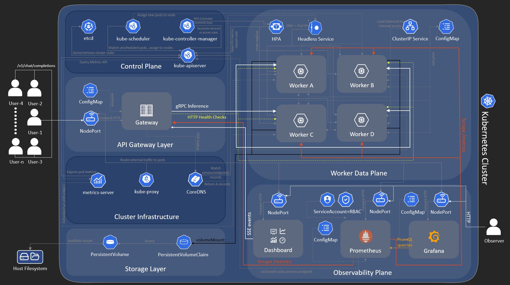

</div>

---

## 📸 Screenshots

Explore the RavexLLM interface and its different features.

### 💬 Chat Application

The conversational interface for interacting with deployed LLMs.

<table>
  <tr>
    <td width="50%">
      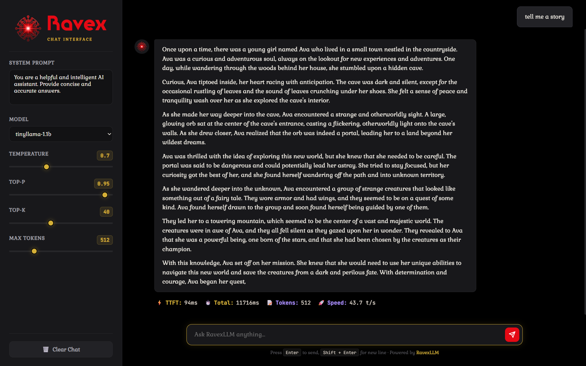
    </td>
    <td width="50%">
      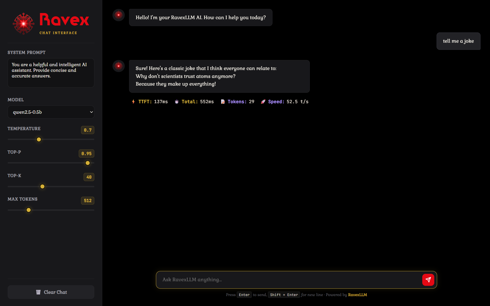
    </td>
  </tr>
</table>

### 📊 Dashboard

The main dashboard for monitoring inference workers, cluster topology, system health, and performance.

<table>
  <tr>
    <td width="50%">
      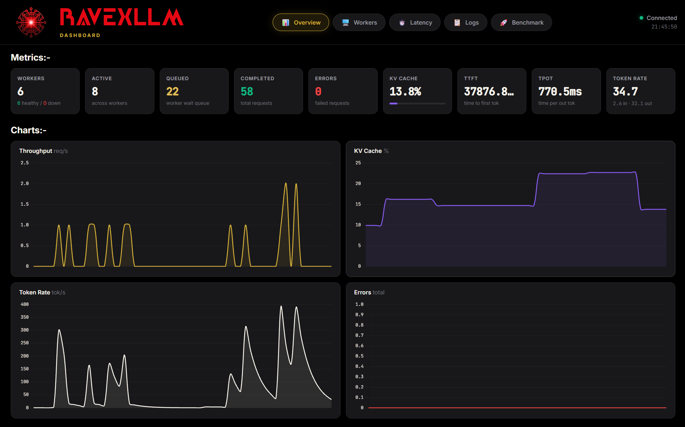
    </td>
    <td width="50%">
      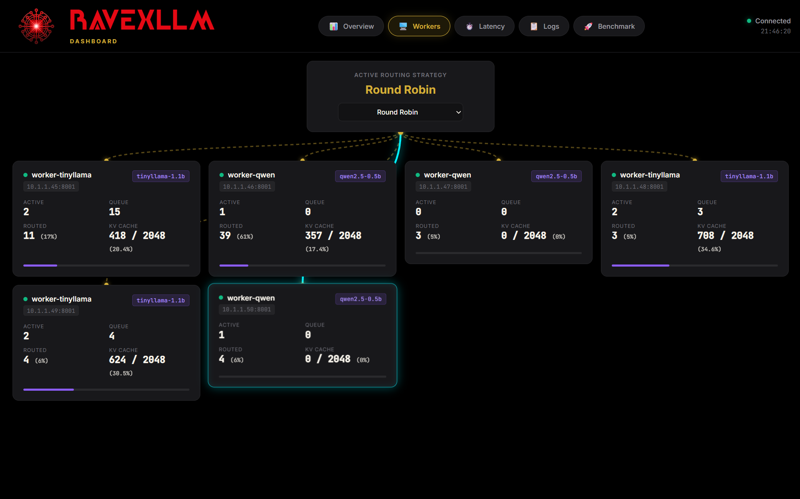
    </td>
  </tr>
  <tr>
    <td width="50%">
      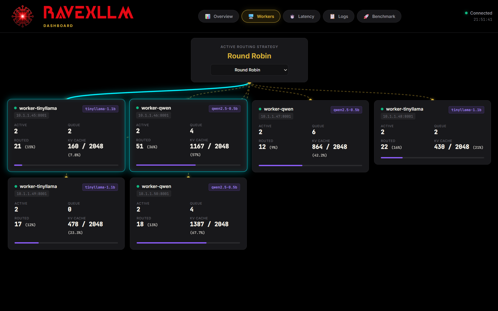
    </td>
    <td width="50%">
      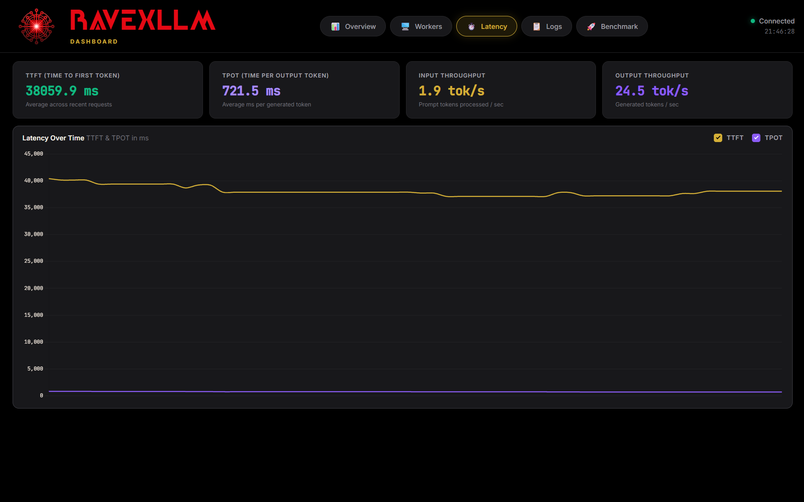
    </td>
  </tr>
  <tr>
    <td width="50%">
      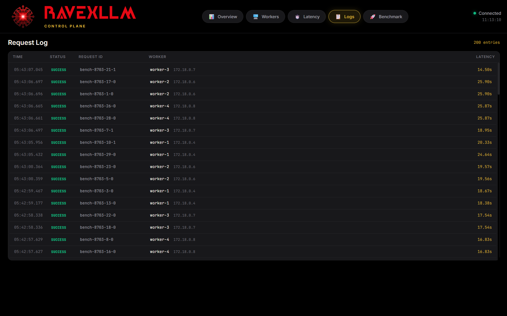
    </td>
    <td width="50%">
      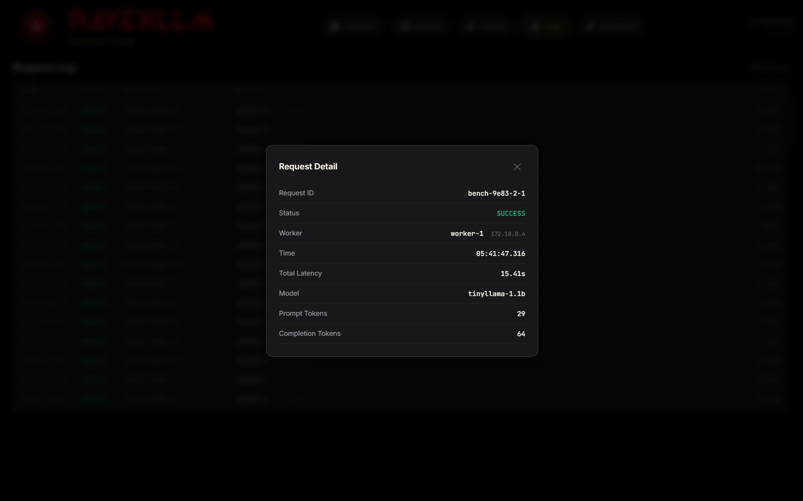
    </td>
  </tr>
  <tr>
    <td width="50%">
      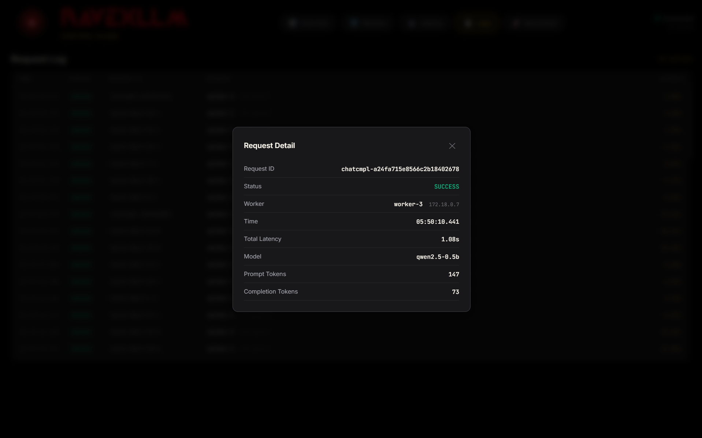
    </td>
  </tr>
</table>

### 🔥 Prometheus Monitoring

Prometheus monitoring interface for inspecting metrics, scrape targets, and PromQL queries.

<table>
  <tr>
    <td width="50%">
      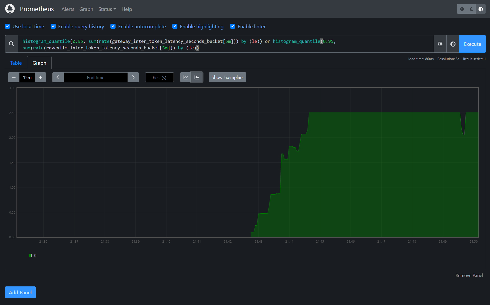
    </td>
    <td width="50%">
      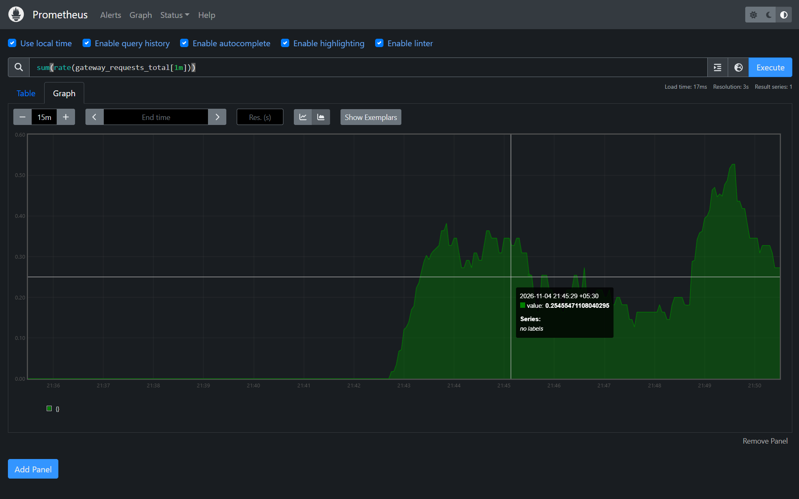
    </td>
  </tr>
  <tr>
    <td width="50%">
      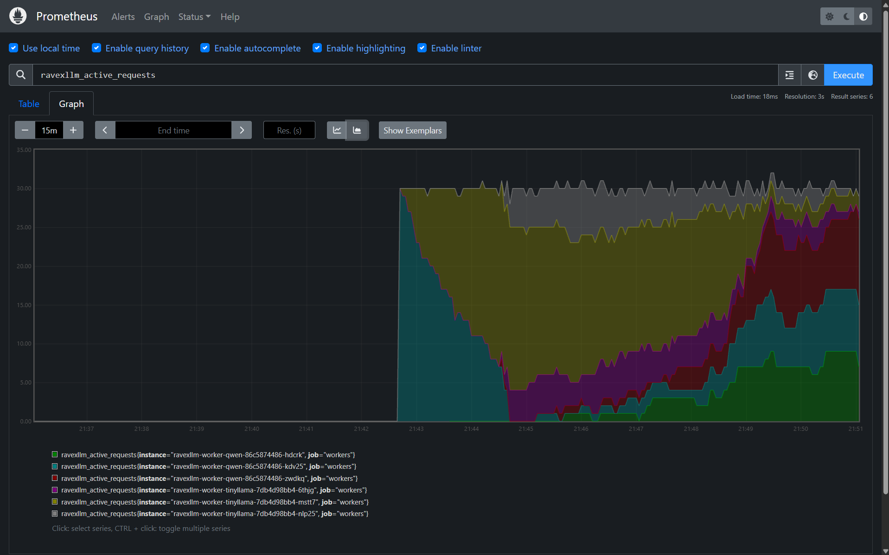
    </td>
  </tr>
</table>

### 📈 Grafana Observability

Grafana dashboards for visualizing system metrics, inference performance, and cluster health.

<table>
  <tr>
    <td width="50%">
      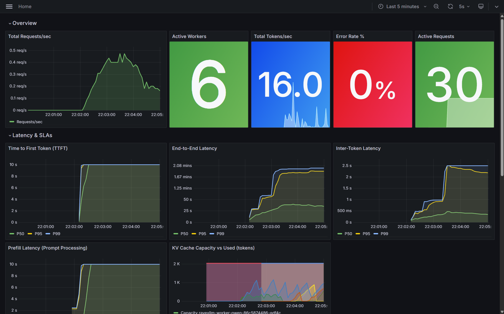
    </td>
    <td width="50%">
      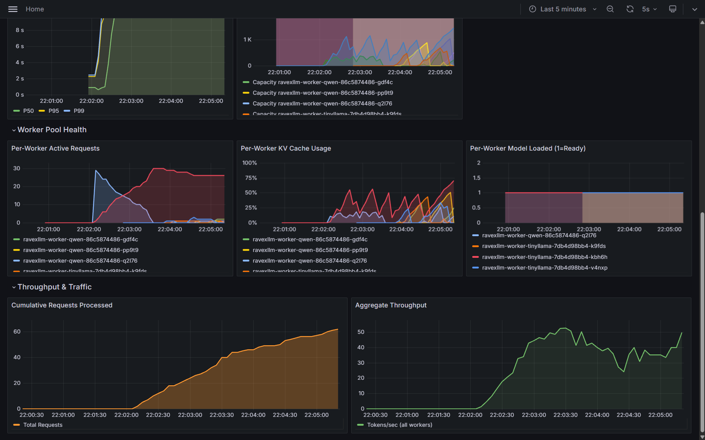
    </td>
  </tr>
</table>

---

## 📋 Prerequisites

Before running RavexLLM, make sure your system has:

- **Docker Desktop** installed.
- **Kubernetes enabled** in Docker Desktop (Settings → Kubernetes).
- At least **8 GB RAM** allocated to Docker Desktop.
- Windows operating system.

---

## 🚀 Download & Installation

### Step 1: Download RavexLLM

Visit the latest GitHub Release:

<div align="center">

  <a href="https://github.com/ayushmani0/Ravex-LLM/releases/latest">

  **⬇️ Download RavexLLM — Latest Release**

  </a>

</div>

Download the application archive (`.zip`).

### Step 2: Extract the Application

1. Locate the downloaded ZIP file.
2. Right-click the ZIP file.
3. Select **Extract All**.
4. Open the extracted RavexLLM folder.

### Step 3: Start RavexLLM

Inside the extracted folder, locate:

`start.bat`

**Double-click `start.bat` to launch RavexLLM.**

That's it! The startup script handles the deployment automatically.

### What Happens Automatically?

1. Verifies that Docker Desktop and Kubernetes are running.
2. Checks for locally available model weights.
3. Downloads model weights from Hugging Face if they are missing.
4. Deploys the complete application cluster to Kubernetes using `kubectl apply -k k8s/`.
5. Waits for inference workers to initialize and load their models.
6. Displays the application URLs once the services are ready.

### Stopping RavexLLM

To stop the application, simply double-click:

`stop.bat`

---

## 🌐 Endpoints & Port Reference

Once RavexLLM is running, access the following services:

| Service | URL | Credentials / Notes |
| :--- | :--- | :--- |
| **Operational Dashboard** | [http://localhost:30888](http://localhost:30888) | Real-time worker health, topology & benchmarks |
| **Chat Web UI** | [http://localhost:30881](http://localhost:30881) | Conversational multi-turn chat interface |
| **Grafana Observability** | [http://localhost:30030](http://localhost:30030) | User: `admin` / Password: `ravexllm` |
| **Prometheus TSDB** | [http://localhost:30090](http://localhost:30090) | Target scrapers & PromQL expression browser |
| **API Gateway (OpenAI API)** | [http://localhost:30080/v1/chat/completions](http://localhost:30080/v1/chat/completions) | Bearer Token: `sk-ravex-secret-1` |

---

## 🔌 API Usage

RavexLLM exposes an OpenAI-compatible Chat Completions API.

**Endpoint:**

`POST http://localhost:30080/v1/chat/completions`

**Authorization:**

`Bearer sk-ravex-secret-1`

Example request:

```bash
curl http://localhost:30080/v1/chat/completions \
  -H "Content-Type: application/json" \
  -H "Authorization: Bearer sk-ravex-secret-1" \
  -d '{
    "model": "ravex",
    "messages": [
      {
        "role": "user",
        "content": "Hello! Explain distributed LLM inference."
      }
    ]
  }'
```
